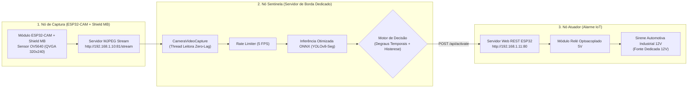
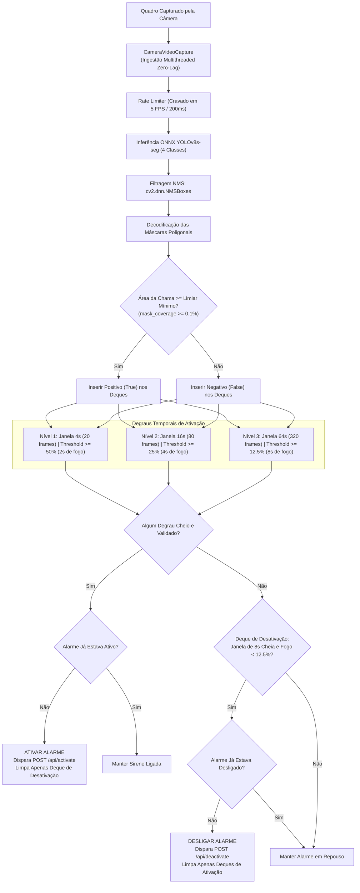

# Sentinela: Sistema de Detecção de Incêndio em Áreas Abertas com Visão Computacional e Atuação IoT

> **Contexto e Propósito:** Este projeto foi concebido e desenvolvido por **José Anselmo** fundamentalmente para **fins de estudo e aprendizado prático** nas áreas de visão computacional, aprendizado profundo (*Deep Learning*) e integração de sistemas embarcados/IoT. Todo o projeto foi executado em colaboração com o agente de inteligência artificial **Gemini 3.8 Flash** (integrado ao **Antigravity IDE**), em uma dinâmica interativa de pair programming onde código, arquitetura e documentação foram continuamente refinados, experimentados e ajustados ao longo do processo.

---

## 1. Escopo do Projeto

O **Sentinela** foi concebido especificamente para a **detecção precoce de focos de incêndio e fumaça em ambientes abertos** — tais como reservas florestais, áreas de preservação ambiental, plantações agrícolas, pastagens e zonas perimetrais rurais.

Nesses ecossistemas, o fogo não faz parte da operação normal: qualquer foco inicial representa uma ameaça crítica com potencial de propagação rápida. O objetivo central é fornecer uma solução de vigilância contínua capaz de identificar chamas e fumaça em seus estágios iniciais e deflagrar alertas sonoros locais (sirenes de alta potência) e acionamentos preventivos de segurança de forma autônoma.

---

## 2. Análise Comparativa de Tecnologias

A proteção contra incêndios florestais e agrícolas enfrenta desafios físicos severos. Abaixo, compara-se a abordagem do Sentinela com as principais alternativas convencionais de mercado:

| Tecnologia                                                                | Ambiente Ideal                                      | Latência de Detecção                                  | Custo de Implantação                                                        | Principais Limitações                                                                                                                                                                  |
| :------------------------------------------------------------------------ | :-------------------------------------------------- | :------------------------------------------------------- | :---------------------------------------------------------------------------- | :--------------------------------------------------------------------------------------------------------------------------------------------------------------------------------------- |
| **Detectores de Fumaça Convencionais** (Ópticos / Iônicos)       | Ambientes internos e fechados                       | Segundos a minutos (após acúmulo de partículas)       | Muito baixo                                                                   | **Inviáveis em áreas abertas.** A dispersão pelo vento impede que partículas de fumaça atinjam o sensor físico em concentrações suficientes.                               |
| **Câmeras Térmicas / Infravermelho (FLIR)**                       | Áreas abertas e industriais                        | Quase instantâneo (segundos)                            | Extremamente alto (milhares de dólares por nó)                              | Custo proibitivo para cobertura em larga escala; exigem calibração térmica periódica; sensíveis a superfícies metálicas aquecidas pelo sol.                                       |
| **Sensoriamento Remoto por Satélite** (INPE, MODIS, FIRMS, GOES)   | Macro monitoramento regional e continental          | Horas a dias (depende da órbita)                        | Baixo para o usuário final (dados públicos)                                 | Resolução espacial grosseira (dezenas a centenas de metros por pixel); detectam o incêndio apenas quando já tomou proporções desastrosas; atraso inviabiliza contenção imediata. |
| **Sentinela** (Visão Computacional na Borda + Módulos de Câmera) | **Áreas abertas com linha de visão direta** | **Instantâneo (1 a 3 segundos de confirmação)** | **Variável** (diretamente atrelado à qualidade das câmeras adotadas) | Depende de campo de visão desobstruído. A eficácia, o alcance e a nitidez dependem diretamente da qualidade do conjunto óptico adotado.                                              |

### Considerações Práticas sobre Custo e Limitações:

* **Custo em Função da Qualidade Óptica:** O custo de implantação não deve ser considerado arbitrariamente baixo. Ele depende diretamente da qualidade dos módulos de câmera escolhidos. Câmeras com sensores superiores, maior alcance dinâmico, lentes adequadas e maior resolução elevam o custo por nó, mas aumentam substancialmente a distância útil de monitoramento e a confiabilidade das predições.
* **Detecção Noturna e Comportamento no Escuro:** Embora a falta de luz ambiente dificulte a percepção visual padrão e a identificação de colunas de fumaça sem iluminação infravermelha auxiliar, o fogo emite luminosidade própria ao queimar, tornando-se um ponto de alto contraste no escuro. A resposta exata do sistema sob escuridão total e o comportamento do ganho automático dos sensores constituem uma hipótese de teste prático prevista no projeto.
* **Processamento e Atuação Local:** A inteligência não depende de conexão com a nuvem para operar, funcionando em rede local dedicada com acionamento físico imediato.

---

## 3. Dados de Treinamento e Atribuição de Créditos

O modelo de visão computacional foi treinado para segmentação de instâncias com base em dados curados e anotados na plataforma Roboflow:

* **Dataset:** `fire-smoke-segmentation` (Versão 1)
* **Fonte:** [Roboflow Universe - fire-smoke-segmentation-3ym8x-2wv2q](https://app.roboflow.com/jose-anselmo-ferreira-matos/fire-smoke-segmentation-3ym8x-2wv2q/1)
* **Volume de Dados:** 3.665 imagens anotadas com polígonos de segmentação para 2 classes distintas:
  * `Classe 0`: **Fogo**
  * `Classe 1`: **Fumaça**
* **Licença:** [Creative Commons Attribution 4.0 International (CC BY 4.0)](https://creativecommons.org/licenses/by/4.0/)

A rotulagem por máscaras de segmentação poligonal (em oposição a caixas delimitadoras simples) foi o fator determinante para permitir o cálculo preciso da área real ocupada pela chama no campo visual.

---

## 4. Estrutura do Repositório

```text
├── bytetrack.yaml               # Parâmetros de rastreamento temporal ByteTrack
├── data.yaml                    # Metadados das classes e caminhos do dataset
├── pyproject.toml               # Gerenciamento de dependências via UV (Python 3.12, ROCm, ONNX, OpenCV)
├── runs/
│   └── fire_alarm_v4/           # Pesos e artefatos de treinamento (4 classes: Fogo, Fumaça, Nuvens, Sol)
│       └── weights/
│           └── best.onnx        # Modelo exportado e otimizado em formato ONNX
├── pio_cam/                     # Firmware do nó de captura de vídeo ESP32-CAM (PlatformIO)
│   ├── platformio.ini           # Configurações de compilação da placa ESP32
│   └── src/
│       ├── CameraWebServer.ino  # Servidor MJPEG streaming na rede local (IP fixo 192.168.1.10)
│       ├── board_config.h       # Mapeamento de pinos do sensor OV5640
│       └── secrets.h            # Credenciais de Wi-Fi e rede
├── pio_siren/                   # Firmware do nó atuador da sirene ESP32 (PlatformIO)
│   ├── platformio.ini           # Configurações de compilação da placa ESP32
│   └── src/
│       ├── WebServer.ino        # Servidor web com endpoints REST para acionamento (/api/activate)
│       └── secrets.h            # Credenciais de rede e IP fixo (192.168.1.11)
├── src/
│   └── detection/
│       ├── sentinel/            # Pacote modular do motor de monitoramento Sentinela
│       │   ├── main.py          # Ponto de entrada e orquestração do sistema
│       │   ├── config.py        # Configurações globais, thresholds e constantes de tempo
│       │   ├── camera_video_capture.py # Ingestão de vídeo multithreaded (Zero-Lag)
│       │   ├── frame_processor.py # Inferência ONNX, decodificação de máscaras e NMS
│       │   ├── video_monitoring_engine.py # Loop de monitoramento, rate-limiter e máquina de estados
│       │   ├── temporal_filter.py # Filtros temporais em deques deslizantes com histerese
│       │   ├── actuator_controller.py # Cliente HTTP assíncrono para os nós atuadores
│       │   └── logger.py        # Logger com auto-limpeza diária de logs obsoletos (30 dias)
│       ├── infer.py             # Script auxiliar de teste e validação preliminar
│       ├── train.py             # Rotina de treinamento do modelo
│       └── export.py            # Rotina de exportação para ONNX
└── storage/                     # Dados persistidos em tempo de execução
    ├── logs/                    # Arquivos diários de log da aplicação
    └── incidents/               # Gravações periciais de vídeo dos eventos de fogo
```

---

## 5. Arquitetura Geral do Sistema

O sistema foi arquitetado de forma agnóstica à câmera: qualquer dispositivo que forneça um fluxo de vídeo contínuo (RTSP ou HTTP) na rede local pode atuar como nó de captura. No ambiente de testes de bancada deste repositório, utilizou-se um ecossistema distribuído com nós microcontrolados dedicados (ESP32) comunicando-se via rede local com o servidor de borda:



### Dinâmica da Operação e Nós de Hardware:

1. **Nó de Captura (ESP32-CAM):** O módulo de câmera captura o vídeo da área vigiada e disponibiliza a transmissão contínua MJPEG na rede local com endereço IP fixo (`192.168.1.10:81/stream`).
2. **Nó Sentinela (Servidor de Borda Dedicado):** O computador central consome os quadros através de uma thread leitora desacoplada e executa a inferência direta via runtime ONNX sem carregar bibliotecas pesadas de treinamento, garantindo processamento rápido, frio e contínuo.
3. **Nó Atuador (ESP32 + Sirene 12V):** Ao consolidar um evento de fogo, o Sentinela despacha uma requisição HTTP REST assíncrona para o nó atuador (`192.168.1.11:80/api/activate`), acionando o relé mecânico isolado que chaveia a sirene física de alta intensidade.

### O Circuito Físico e Montagem de Bancada:

A bancada de testes de desenvolvimento e validação foi montada de forma enxuta e funcional dividida em dois nós físicos:

1. **Nó de Visão (Captura):**

   * **Módulo ESP32-CAM (Ai-Thinker):** Equipado com sensor óptico OV5640 transmitindo fluxo de vídeo contínuo MJPEG em resolução nativa QVGA (320×240).
   * **Shield ESP32-CAM-MB:** Placa-base acoplada ao módulo contendo interface serial USB-UART (CH340), botão de reset e conector Micro-USB, fornecendo alimentação regulada estável de 5V e dispensando adaptadores FTDI avulsos na bancada.
2. **Nó de Atuação (Alarme IoT):**

   * **Microcontrolador:** 1x ESP32 NodeMCU executando o servidor REST HTTP assíncrono.
   * **Módulo Relé:** Relé de 2 canais com acionamento optoacoplado e LED indicador de estado.
   * **Atuador Sonoro:** Sirene de marcha a ré automotiva (12V).
   * **Alimentação e Conectividade:** Conector Jack P4 fêmea para entrada de 12V da fonte externa e jumpers para interligação dos sinais lógicos (GPIO) e alimentação.

### Construção Customizada do Servidor de Borda (Mini PC):

O processamento do Sentinela foi dimensionado para executar localmente em hardware acessível, sem dependência de placas de vídeo dedicadas de alto consumo:

* **Gabinete:** **Metalfish S3** em alumínio escovado — dimensões minúsculas de apenas **200 × 105 × 250 mm** (~4,5 litros de volume total), garantindo pegada física mínima na bancada ou em campo.
* **Processador:** Intel Core i7-3770 (4 núcleos / 8 threads @ 3.4 GHz)
* **Memória:** 16 GB DDR3 Dual-Channel
* **Placa-Mãe:** Bluecase BMBH61-D (Chipset Intel H61)
* **Gestão Térmica:** Substituição do cooler padrão pelo air cooler **Metalfish DH380**. Em teste contínuo de estresse a 100% de CPU por 20 minutos, a temperatura máxima caiu de **95°C para 83°C–84°C estáveis**.
* **Deploy e Confiabilidade:** Planejado para execução conteinerizada em **Docker** (`docker compose` com flag `--restart unless-stopped`), garantindo inicialização automática como serviço (*headless*) caso o sistema reinicie após falta de energia.

---

## 6. Lógica de Decisão do Sentinela

Para evitar o acionamento indevido de sirenes em locais isolados e garantir resposta proporcional à intensidade do fogo, o Sentinela aplica um conjunto estrito de regras determinísticas com concorrência e histerese:



### Detalhamento das Regras de Engenharia:

1. **Ingestão Zero-Lag e Limitador de Cadência (`MAX_PROCESSED_FPS = 5`):**

   * **Buffer Unitário:** A classe `CameraVideoCapture` isola a recepção de pacotes de rede em uma thread secundária. A thread principal lê apenas a referência mais recente (`latest_frame`), descartando frames antigos sem decodificá-los, eliminando qualquer atraso cumulativo no OpenCV.
   * **Cadência Cravada:** Utilizando `time.perf_counter()`, o motor de inferência mantém o ciclo estritamente em **200 ms por quadro (5.0 FPS)**, deixando a CPU do servidor de borda operando fria com carga mínima.
2. **Validação de Área de Cobertura (`TARGET_MINIMUM_COVERAGE = 0.001`):**

   * Em vez de confiar apenas na pontuação de probabilidade (*confidence score*), o algoritmo avalia a razão de píxeis ativos da máscara em relação ao total da tela:
     $$
     \text{mask\_coverage} = \frac{\sum \text{píxeis da máscara}}{\text{largura} \times \text{altura}}
     $$
   * Se a cobertura for inferior a 0,1% do enquadramento, o quadro é ignorado. Isso elimina disparos decorrentes de pequenas faíscas distantes, reflexos momentâneos de luz solar em folhas ou insetos voando próximos à lente.
3. **Filtros Temporais em Degraus de Exposição:**

   * O fogo em campo aberto pode surgir como uma labareda repentina e forte ou como um foco incipiente intermitente fustigado pelo vento. Para responder adequadamente a ambos os cenários, o Sentinela utiliza múltiplos deques simultâneos em potências de tempo:
     * **Nível 1 (Chama violenta/alta exposição):** Janela de 4 segundos (20 frames). Exige 50% de presença (ao menos **2 segundos** com fogo).
     * **Nível 2 (Chama moderada):** Janela de 16 segundos (80 frames). Exige 25% de presença (ao menos **4 segundos** acumulados com fogo).
     * **Nível 3 (Chama intermitente/distante):** Janela de 64 segundos (320 frames). Exige 12.5% de presença (ao menos **8 segundos** dispersos na janela).
   * A validação de qualquer um dos níveis é suficiente para armar o sistema.
4. **Lógica de Desativação Desacoplada e Histerese Assimétrica:**

   * **Desacoplamento:** O desarme do alarme **não compartilha os deques de ativação**. Ele possui um deque próprio de desativação configurado para **8 segundos** (40 frames) com limiar $< 12.5\%$ de fogo residual.
   * **Prevenção de Repique (*Anti-Flapping*):** Ao transicionar de estado (de inativo para ativo, ou vice-versa), o motor limpa **apenas os filtros do tipo oposto**. Isso impede que o alarme fique oscilando (ligando e desligando rapidamente) se a chama estiver na borda de detecção.
5. **Decisão de Projeto: Supressão do Cálculo de Taxa de Crescimento:**

   * Em cenários industriais fechados (como caldeiras ou cozinhas), é comum medir a velocidade de expansão do fogo para determinar se a chama está fora de controle antes de agir.
   * **Em áreas externas abertas (florestas e plantações), essa métrica foi propositalmente omitida.** Em reservas ambientais ou áreas agrícolas, a política é de **tolerância zero**: a presença confirmada de fogo, independentemente de estar crescendo ou estável, já é uma anomalia severa que exige intervenção imediata. Esperar o fogo crescer para confirmar o alerta aumentaria desnecessariamente o tempo de resposta e o risco de devastação.

---

## 7. Demonstrações e Resultados Visuais

### Segmentação de Instâncias nos Dados de Validação

Visualização das predições do modelo com a sobreposição precisa das máscaras de píxeis para fogo e fumaça:

<div align="center">
  
  <p><em>Figura 1: Validação do modelo com delimitação geométrica precisa dos focos de incêndio e fumaça.</em></p>
</div>

### Desempenho e Métricas de Treinamento

| Curvas de Perda e Convergência (mAP50 / mAP50-95) | Matriz de Confusão Normalizada |
| :------------------------------------------------: | :-----------------------------: |
|                                                    |                                |

---

### Demonstrações em Vídeo

#### Validação Integrada do Sistema (Detecção, Rede e Acionamento)

Demonstração do Sentinela em execução contínua: recepção da transmissão de vídeo do nó de câmera ESP32-CAM via rede local, processamento com decodificação de máscaras e inferência ONNX em tempo real, validação do degrau temporal, envio do comando REST de ativação para o nó da sirene e desligamento seguro com histerese:

<div align="center">
  <video src="demo.mp4" width="420px" controls></video>
  <p>
    <a href="demo.mp4">▶️ <strong>Assistir ao vídeo da demonstração (demo.mp4)</strong></a>
  </p>
  <p><em>Vídeo 1: Demonstração prática do pipeline completo do Sentinela em funcionamento.</em></p>
</div>

##### Interpretação Prática da Demonstração:

* **Cadência Cravada em 5 FPS (`MAX_PROCESSED_FPS = 5`):** Nota-se na atualização dos quadros e nos registros de console que o motor opera deliberadamente a **5 quadros por segundo (ciclo exato de 200 ms)**. Em monitoramento de incêndios em áreas abertas, processar vídeo a 30 ou 60 FPS representaria um desperdício desnecessário de processamento e calor. A cadência de 5 FPS garante 5 amostragens visuais por segundo — margem temporal abundante para acompanhar a evolução física da chama — mantendo a CPU do mini PC operando fria e com folga térmica contínua.
* **Sinalização Visual da Ativação (LED do Relé):** A validação foi gravada às 03:00 da madrugada em ambiente residencial. Por motivos óbvios de tranquilidade pública, a sirene automotiva de ré foi mantida fisicamente desligada da alimentação; a confirmação instantânea do disparo físico pode ser acompanhada pelo **LED indicador de estado acoplado ao módulo relé de 2 canais**, que acende no momento exato em que a requisição de acionamento é recebida.
* **Detecção Rápida nos Primeiros Segundos:** O fogo é detectado logo no início da cena porque atinge os parâmetros do **primeiro degrau temporal de ativação (Nível 1: janela de 4 segundos com threshold de 50%)**, confirmando com precisão a persistência da chama sem falsos disparos.
* **Desativação Retardada com Histerese:** Quando a chama cessa, nota-se que o relé não desliga imediatamente. Esse comportamento é proposital e decorre da **regra de desativação desacoplada**, que exige que a janela móvel de **8 segundos registre menos de 12.5% de presença de fogo** para considerar o evento totalmente extinto, prevenindo oscilações bruscas (*alarm flapping*).

---

## 8. Como Executar

### 1. Instalação do Ambiente

Recomenda-se o uso do gerenciador de pacotes [`uv`](https://docs.astral.sh/uv/):

```bash
git clone https://github.com/jafmatos/cv_fire_alarm.git
cd cv_fire_alarm

# Sincronizar o ambiente virtual isolado
uv sync
```

### 2. Configuração de Parâmetros

No arquivo [`src/detection/sentinel/config.py`](src/detection/sentinel/config.py), configure os endereços IP dos nós ESP32 e parâmetros do motor:

```python
VIDEO_STREAM_IP = "192.168.1.10"                # IP estático do nó de câmera ESP32-CAM
SIREN_IP = "192.168.1.11"                       # IP estático do nó atuador da sirene
MAX_PROCESSED_FPS = 5                           # Cadência do rate limiter em FPS
```

### 3. Inicialização do Monitoramento

```bash
uv run python src/detection/sentinel/main.py
```
