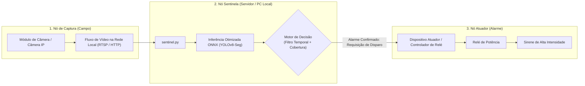
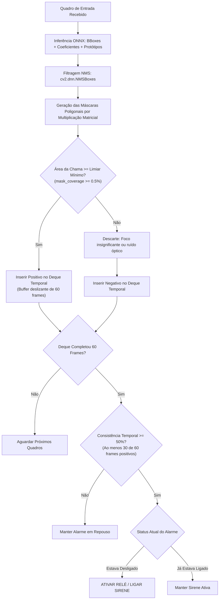

# Sentinela: Sistema de Detecção de Incêndio em Áreas Abertas com Visão Computacional e Atuação IoT

> **Contexto e Propósito:** Este projeto foi concebido e desenvolvido por **José Anselmo** fundamentalmente para **fins de estudo e aprendizado prático** nas áreas de visão computacional, aprendizado profundo (*Deep Learning*) e integração de sistemas embarcados/IoT. Todo o projeto foi executado em colaboração com o agente de inteligência artificial **Gemini 3.8 Flash** (integrado ao **Antigravity IDE**), em uma dinâmica interativa de pair programming onde código, arquitetura e documentação foram continuamente refinados, experimentados e ajustados ao longo do processo.

---

## 1. Escopo do Projeto

O **Sentinela** foi concebido especificamente para a **detecção precoce de focos de incêndio e fumaça em ambientes abertos** — tais como reservas florestais, áreas de preservação ambiental, plantações agrícolas, pastagens e zonas perimetrais rurais.

Nesses ecossistemas, o fogo não faz parte da operação normal: qualquer foco inicial representa uma ameaça crítica com potencial de propagação rápida. O objetivo central é fornecer uma solução de vigilância contínua capaz de identificar chamas e fumaça em seus estágios iniciais e deflagrar alertas sonoros locais (sirenes de alta potência) e acionamentos preventivos de segurança de forma autônoma.

---

## 2. Análise Comparativa de Tecnologias

A proteção contra incêndios florestais e agrícolas enfrenta desafios físicos severos. Abaixo, compara-se a abordagem do Sentinela com as principais alternativas convencionais de mercado:

| Tecnologia | Ambiente Ideal | Latência de Detecção | Custo de Implantação | Principais Limitações |
| :--- | :--- | :--- | :--- | :--- |
| **Detectores de Fumaça Convencionais** (Ópticos / Iônicos) | Ambientes internos e fechados | Segundos a minutos (após acúmulo de partículas) | Muito baixo | **Inviáveis em áreas abertas.** A dispersão pelo vento impede que partículas de fumaça atinjam o sensor físico em concentrações suficientes. |
| **Câmeras Térmicas / Infravermelho (FLIR)** | Áreas abertas e industriais | Quase instantâneo (segundos) | Extremamente alto (milhares de dólares por nó) | Custo proibitivo para cobertura em larga escala; exigem calibração térmica periódica; sensíveis a superfícies metálicas aquecidas pelo sol. |
| **Sensoriamento Remoto por Satélite** (INPE, MODIS, FIRMS, GOES) | Macro monitoramento regional e continental | Horas a dias (depende da órbita) | Baixo para o usuário final (dados públicos) | Resolução espacial grosseira (dezenas a centenas de metros por pixel); detectam o incêndio apenas quando já tomou proporções desastrosas; atraso inviabiliza contenção imediata. |
| **Sentinela** (Visão Computacional na Borda + Módulos de Câmera) | **Áreas abertas com linha de visão direta** | **Instantâneo (1 a 3 segundos de confirmação)** | **Variável** (diretamente atrelado à qualidade das câmeras adotadas) | Depende de campo de visão desobstruído. A eficácia, o alcance e a nitidez dependem diretamente da qualidade do conjunto óptico adotado. |

### Considerações Práticas sobre Custo e Limitações:
* **Custo em Função da Qualidade Óptica:** O custo de implantação não deve ser considerado arbitrariamente baixo. Ele depende diretamente da qualidade dos módulos de câmera escolhidos. Câmeras com sensores superiores, maior alcance dinâmico, lentes adequadas e maior resolução elevam o custo por nó, mas aumentam substancialmente a distância útil de monitoramento e a confiabilidade das predições.
* **Detecção Noturna e Comportamento no Escuro:** Embora a falta de luz ambiente dificulte a percepção visual padrão e a identificação de colunas de fumaça sem iluminação infravermelha auxiliar, o fogo emite luminosidade própria ao queimar, tornando-se um ponto de alto contraste no escuro. A resposta exata do sistema sob escuridão total e o comportamento do ganho automático dos sensores constituem uma hipótese de teste prático prevista no projeto.
* **Processamento e Atuação Local:** A inteligência não depende de conexão com a nuvem para operar, funcionando em rede local dedicada com acionamento físico imediato.

---

## 3. Dados de Treinamento e Atribuição de Créditos

O modelo de visão computacional foi treinado para segmentação de instâncias com base em dados curados e anotados na plataforma Roboflow:

* **Dataset:** `fire-smoke-segmentation` (Versão 1)
* **Fonte:** [Roboflow Universe - fire-smoke-segmentation-3ym8x-2wv2q](https://app.roboflow.com/jose-anselmo-ferreira-matos/fire-smoke-segmentation-3ym8x-2wv2q/1)
* **Volume de Dados:** 3.665 imagens anotadas com polígonos de segmentação para 2 classes distintas:
  * `Classe 0`: **Fogo**
  * `Classe 1`: **Fumaça**
* **Licença:** [Creative Commons Attribution 4.0 International (CC BY 4.0)](https://creativecommons.org/licenses/by/4.0/)

A rotulagem por máscaras de segmentação poligonal (em oposição a caixas delimitadoras simples) foi o fator determinante para permitir o cálculo preciso da área real ocupada pela chama no campo visual.

---

## 4. Estrutura do Repositório

```text
├── bytetrack.yaml               # Parâmetros de rastreamento temporal ByteTrack
├── data.yaml                    # Metadados das classes e caminhos do dataset
├── pyproject.toml               # Gerenciamento de dependências via UV (Python 3.12, ROCm, ONNX, OpenCV)
├── runs/
│   └── fire_alarm_v2/           # Resultados e artefatos de treinamento
│       ├── weights/
│       │   └── best.onnx        # Modelo exportado e otimizado em formato ONNX
│       ├── results.png          # Curvas de convergência e métricas (mAP50, mAP50-95)
│       └── confusion_matrix_normalized.png
├── pio_cam/
│   └── fire_alarm_cam/          # Firmware para nó de teste baseado em microcontrolador
│       ├── platformio.ini       # Configurações de compilação da placa ESP32
│       └── src/
│           ├── CameraWebServer.ino # Servidor de vídeo streaming na rede local
│           └── board_config.h   # Mapeamento de pinos do módulo de câmera
├── src/
│   └── detection/
│       ├── sentinel.py          # Núcleo de inferência ONNX, lógica de decisão e acionamento
│       └── infer.py             # Script auxiliar de teste e validação preliminar
└── guide/                       # Documentação técnica e fundamentos teóricos
```

---

## 5. Arquitetura Geral do Sistema

O sistema foi arquitetado de forma agnóstica à câmera: qualquer dispositivo que forneça um fluxo de vídeo contínuo (RTSP ou HTTP) na rede local pode atuar como nó de captura. No ambiente de testes de bancada deste repositório, utilizou-se um módulo microcontrolado com câmera para validação do pipeline:



### Dinâmica da Operação:
1. **Nó de Captura:** O módulo de câmera captura o vídeo da área vigiada e disponibiliza a transmissão contínua na rede local.
2. **Nó Sentinela:** O computador central consome os quadros de vídeo e executa a inferência direta via runtime ONNX sem carregar bibliotecas pesadas de treinamento, garantindo processamento rápido e contínuo.
3. **Nó Atuador:** Ao consolidar um evento de fogo, o Sentinela envia um comando (via requisição de rede para um nó atuador dedicado ou comando serial) para fechar o circuito de um relé e disparar a sirene física.

---

## 6. Lógica de Decisão do Sentinela

Para evitar o acionamento indevido de sirenes em locais isolados, o Sentinela aplica um conjunto estrito de regras determinísticas antes de validar uma ocorrência:



### Detalhamento das Regras de Engenharia:

1. **Validação de Área de Cobertura (`TARGET_MINIMUM_COVERAGE = 0.005`):**
   * Em vez de confiar apenas na pontuação de probabilidade (*confidence score*), o algoritmo avalia a razão de píxeis ativos da máscara em relação ao total da tela:
     $$\text{mask\_coverage} = \frac{\sum \text{píxeis da máscara}}{\text{largura} \times \text{altura}}$$
   * Se a cobertura for inferior a 0,5% do enquadramento, o quadro é ignorado. Isso elimina disparos decorrentes de pequenas faíscas distantes, reflexos momentâneos de luz solar em folhas ou insetos voando próximos à lente.

2. **Consistência Temporal via Buffer Deslizante (`TemporalFilter`):**
   * Chamas e fumaças reais são fenômenos persistentes no tempo. Perturbações ópticas, por outro lado, duram poucos milissegundos.
   * Utiliza-se um `collections.deque(maxlen=60)`. Para o alarme armar, ao menos **50% dos últimos 60 quadros analisados** devem satisfazer os critérios de detecção e área simultaneamente.

3. **Decisão de Projeto: Supressão do Cálculo de Taxa de Crescimento:**
   * Em cenários industriais fechados (como caldeiras ou cozinhas), é comum medir a velocidade de expansão do fogo para determinar se a chama está fora de controle antes de agir.
   * **Em áreas externas abertas (florestas e plantações), essa métrica foi propositalmente omitida.** Em reservas ambientais ou áreas agrícolas, a política é de **tolerância zero**: a presença confirmada de fogo, independentemente de estar crescendo ou estável, já é uma anomalia severa que exige intervenção imediata. Esperar o fogo crescer para confirmar o alerta aumentaria desnecessariamente o tempo de resposta e o risco de devastação.

---

## 7. Demonstrações e Resultados Visuais

### Segmentação de Instâncias nos Dados de Validação
Visualização das predições do modelo com a sobreposição precisa das máscaras de píxeis para fogo e fumaça:

<div align="center">
  
  <p><em>Figura 1: Validação do modelo com delimitação geométrica precisa dos focos de incêndio e fumaça.</em></p>
</div>

### Desempenho e Métricas de Treinamento

| Curvas de Perda e Convergência (mAP50 / mAP50-95) | Matriz de Confusão Normalizada |
| :---: | :---: |
|  |  |

---

### Demonstrações em Vídeo

#### Demonstração Preliminar de Bancada (Sistema Conectado ao Computador)
> **Vídeo de Bancada:** Espaço reservado para o teste preliminar do sistema integrado, exibindo a recepção da transmissão de vídeo na rede local, o processamento em tempo real pelo script `sentinel.py` e o chaveamento mecânico do relé de bancada conectado ao computador pessoal.
>
> *(Inserir vídeo/GIF da tela de monitoramento e do acionamento do relé)*

#### Teste Controlado em Campo (Atuação Real com Fogo e Sirene)
> **Vídeo de Campo:** Espaço reservado para o teste prático de validação externa, com ignição de fogo controlado no quintal/campo (inclusive sob condições de baixa luminosidade para avaliar a autoemissão de luz da chama) e verificação do acionamento sonoro da sirene de alta intensidade.
>
> *(Inserir vídeo da demonstração externa)*

---

## 8. Como Executar

### 1. Instalação do Ambiente
Recomenda-se o uso do gerenciador de pacotes [`uv`](https://docs.astral.sh/uv/):

```bash
git clone https://github.com/jafmatos/cv_fire_alarm.git
cd cv_fire_alarm

# Sincronizar o ambiente virtual isolado
uv sync
```

### 2. Configuração de Parâmetros
No arquivo [`src/detection/sentinel.py`](src/detection/sentinel.py), configure o endpoint de vídeo e a interface de acionamento do relé:

```python
VIDEO_SOURCE = "http://192.168.1.26:81/stream"  # Endpoint de vídeo na rede (ou 0 para webcam local)
RELAY_PORT = "/dev/ttyUSB1"                     # Interface de comunicação com o atuador
```

### 3. Inicialização do Monitoramento
```bash
uv run python src/detection/sentinel.py
```
